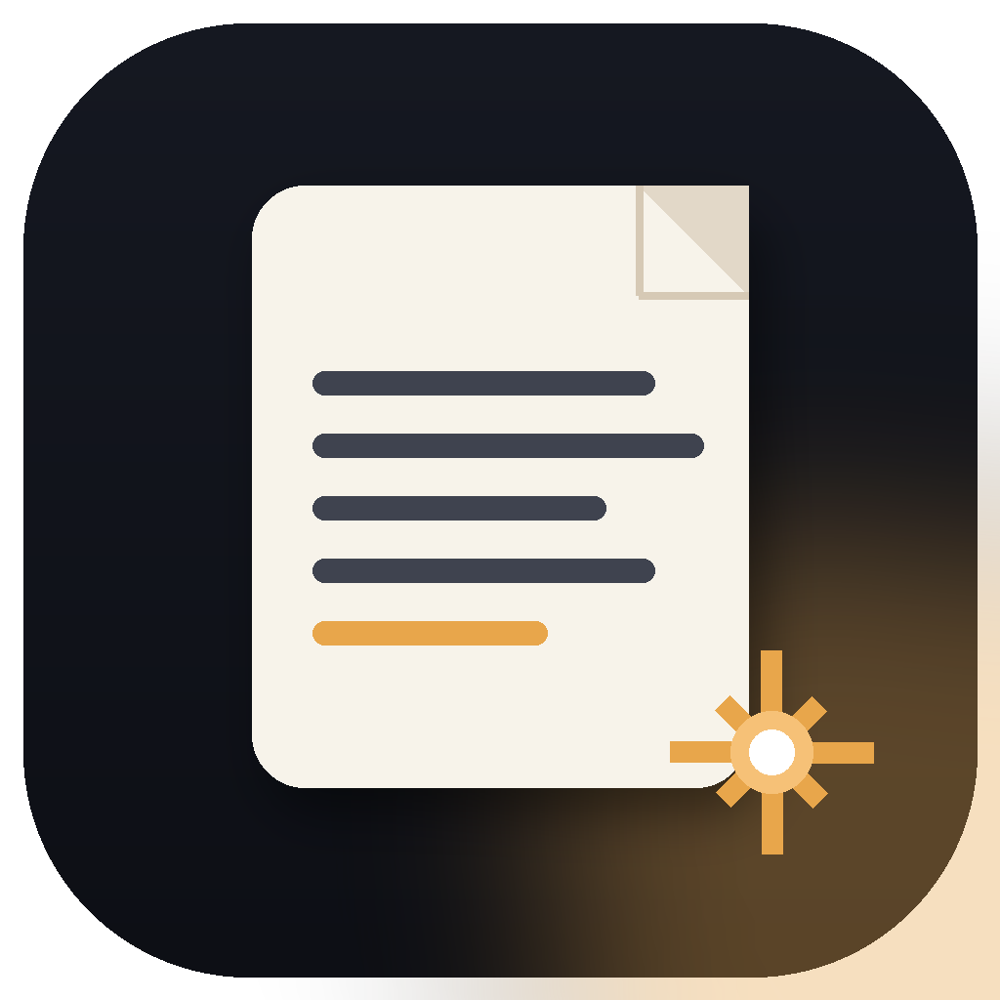
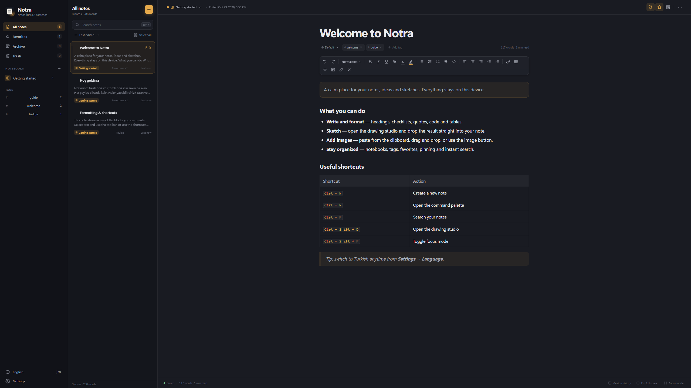

<p align="center">
  
</p>

<h1 align="center">Notra</h1>

<p align="center">
  <strong>Local-first notes, sketches and tables for Windows.</strong><br>
  Everything stays on your device.
</p>

<p align="center">
  <strong>English</strong> · <a href="README.tr.md">Türkçe</a>
</p>

<p align="center">
  <a href="https://github.com/Whitich/Notra/releases/latest/download/Notra-Setup-1.0.0.exe">
    
  </a>
</p>

<p align="center">
  <a href="https://github.com/Whitich/Notra/releases/latest">Latest release</a> ·
  <a href="README.tr.md">Türkçe README</a>
</p>



## About

Notra is a fast, local-first note-taking app for Windows. Write and format notes, sketch ideas, insert images, build tables, and keep everything organized with notebooks, tags, favorites, pinning, archive and trash.

There is no account, no cloud requirement and no telemetry. Your notes live in a local SQLite database on your computer.

## Download

Use the button above to download **Notra Setup 1.0.0** directly.

- Installer: `Notra-Setup-1.0.0.exe`
- Size: approximately 11.7 MB
- Installed size: approximately 25 MB
- Install scope: current Windows user, no administrator rights required

> [!NOTE]
> The installer is not code-signed yet. If Windows SmartScreen shows a warning, choose **More info → Run anyway**.

## Features

- Rich-text editor with headings, lists, checklists, quotes, code, links, colors and tables
- Table tools for adding or removing rows and columns, with Tab navigation between cells
- Drawing studio; insert sketches directly into a note
- Images via paste, drag and drop, or the image picker
- Full-text search across your notes
- Notebooks, tags, pinning, favorites, archive and trash
- Revision history with restore
- Autosave and draft recovery
- JSON backup and restore
- Export to HTML, Markdown, plain text and PDF
- Word count, reading time and writing statistics
- Focus mode, command palette and full-screen mode
- Light, dark and system themes
- English and Turkish interface
- Keyboard shortcuts for everyday actions

## System requirements

- Windows 10 or Windows 11, 64-bit
- Microsoft Edge WebView2 Runtime
- No internet connection is required after installation

WebView2 is included with current Windows versions and Microsoft Edge. If it is missing, install it from the [official WebView2 page](https://developer.microsoft.com/microsoft-edge/webview2/).

## Privacy and data

Notra stores its data in:

```text
%APPDATA%\Notra
```

The main files are `notra.db`, the `backups` folder and the local WebView2 cache.

- No account or sign-in
- No cloud sync
- No ads or telemetry
- Backups and exports are created only when you request them
- Your notes remain on your device

You can export a full JSON backup from **Settings → Data**.

## Keyboard shortcuts

| Action | Shortcut |
| --- | --- |
| New note | `Ctrl + N` |
| Command palette | `Ctrl + K` |
| Search notes | `Ctrl + F` |
| Save now | `Ctrl + S` |
| Drawing studio | `Ctrl + Shift + D` |
| Focus mode | `Ctrl + Shift + F` |
| Full screen | `F11` |
| Settings | `Ctrl + ,` |
| Bold / italic / underline | `Ctrl + B` / `Ctrl + I` / `Ctrl + U` |
| Checklist | `Ctrl + Shift + C` |
| Print or PDF | `Ctrl + P` |
| Help | `F1` |
| Exit full screen or close a dialog | `Esc` |

Inside a table, use `Tab` and `Shift + Tab` to move between cells. Pressing `Tab` in the last cell adds a new row.

## Development

Requirements: Python 3.12 on Windows.

```powershell
git clone https://github.com/Whitich/Notra.git
cd Notra
python -m venv .venv
.\.venv\Scripts\Activate.ps1
pip install -r requirements.txt
python entry.py
```

Run the app with a temporary data directory:

```powershell
$env:NOTRA_DATA_DIR = "$env:TEMP\Notra-Dev"
python entry.py
```

## Build the Windows installer

Install [Inno Setup 6](https://jrsoftware.org/isinfo.php), then run:

```powershell
powershell -ExecutionPolicy Bypass -File .\build.ps1
```

Build output:

```text
dist\Notra\Notra.exe
dist\Notra-Setup-1.0.0.exe
```

The build script locates Inno Setup in its standard installation folders. You can also pass `-SkipInstaller` to build only the PyInstaller app.

## Project structure

```text
app/            Python backend, SQLite store and pywebview API
ui/             HTML, CSS, JavaScript and translations
ui/assets/      Assets bundled with the interface
assets/         Application icons
docs/           README screenshots
build.ps1       PyInstaller and Inno Setup build script
installer.iss   Inno Setup configuration
notra.spec      PyInstaller configuration
```

## Download verification

SHA-256 for `Notra-Setup-1.0.0.exe`:

```text
0AC49CDF1B1D010557720E0B58403BCB239851D63FE0CC7FEF563AF464AB7F8B
```

---

Built by [Mert HARMANKAŞI (@Whitich)](https://github.com/Whitich).
